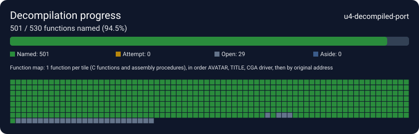

Lots of information/tools/remakes about "Ultima IV - Quest Of The Avatar" have been made, but so far, no one really gave an insight of the binary itself. To be more precise, of the executables of the PC version of the game (ported by James Van Artsdalen).
There are two of them: AVATAR.EXE and TITLE.EXE

Basically, what I did is reverse engineer them to obtain a list of source files, that, when compiled and linked, produce new executables very close to the original ones (there are maybe 10 bytes difference for each executable).

Some of the source files are in assembly code.
The biggest chunk is in C language, which means that it should be easier to read it.
Of course, since this is a reverse-engineered from binary, files|variables|functions names were lost and I had to come up with new naming. I hope you like it.

Concerning the compiler, I used "Microsoft C Compiler 4.00". Which is certainly the version that was used to build the original game.

Very good remakes of the game exist already; this project is not intended to compete with them at all. Instead, interested people can take a look at the code to understand some algorithms, coding technics from another age, ...

I hope you enjoy browsing the code !
ergonomy_joe

---

## Readable version (branch `master`)

One tile per function of `SRC/`, `SRC-TITLE/` and `SRC-DRV/` (C functions and assembly procedures), regenerated by
`python3 tools/progress.py`. Green means the function has a source and a real name; grey tiles are the 29 assembly
procedures that still have an address placeholder for a name (TITLE's `GRAPH.ASM` and `INFLATE.ASM`, and the CGA
driver). EGA.DRV and TANDY.DRV were not reversed, so they have no tiles. The count reads the sources only; it does not
rebuild or compare bytes (see "Checking that nothing changed").

Against the GOG release (`python3 tools/unexepack.py --compare gamedata/AVATAR.EXE BUILT.EXE`, with the programs
`tools/dosbuild.py --keep DIR` leaves): the built `AVATAR.EXE` has the same load image as GOG's once that is
unpacked, with the same entry point, stack and relocations. Only the uninitialised data at the end differs, as zeros
that EXEPACK drops. GOG's copy reaches its EXEPACK unpacker through a small extra jump stub, which `unexepack.py`
follows. `TITLE.EXE` (not packed) differs in 3 bytes: the shipped file has `AskForDisk` (`C_2F07`, marked
`%%% hacked %%%` in the source) patched to jump past the disk prompt, and the source keeps the unpatched function.
Neither the stub nor the patch is reproduced by the build.

On this branch the source has been rewritten for readability **without changing the generated
code**: it still builds an `AVATAR.EXE` and a `TITLE.EXE` identical to the ones built from
ergonomy_joe's sources (kept unchanged on the branch `original`), checked with the original
compiler (below). What the work taught, and the traps of Microsoft C 4.00 it ran into, are in
[docs/LESSONS-DECOMPILATION.md](docs/LESSONS-DECOMPILATION.md).

What changed:
* **Names.** Every function, global and structure member that had an address placeholder
  (`C_2F7E`, `D_8742`, `f_1d8`, ...) has a real name (`WaitKeyOrTimeout`, `Area`,
  `Party._members`, ...). The old address stays in a comment in front of every renamed
  definition and declaration (`/*C_2F7E*/WaitKeyOrTimeout()`), so the source can still be
  matched with a disassembly. `tools/rename_map.json` maps the old names to the new ones.
* **Locals and parameters.** Register and stack names (`si`, `bp06`, `bp_02`, `loc_A`, ...) are
  replaced by meaningful names in every function.
* **Constants.** Tiles (`TIL_SHIP_W`, `TIL_LORD_BRITISH`, ...), sounds (`SND_HIT`), indexes into
  the name table (`NAME_VIRTUES`), classes, weapons and armours have names instead of numbers.
* **Comments.** Every function has a comment saying what it does; wrong old comments were fixed.
* **Findings.** [`FINDINGS.md`](FINDINGS.md) lists the probable bugs and quirks of the original
  game that turned up while reading the code.
* **Mechanics.** [`docs/MECHANICS.md`](docs/MECHANICS.md) describes how the game works, read from
  the code: time, conversation, quest progression, stats and combat, with the exact numbers.

Not changed: control flow, expressions, declaration order, data, file names and the assembly
code (only the symbols shared with C, and private labels, were renamed).

Two constraints of Microsoft C 4.00 shaped the renaming:
* It lays out a function's locals in the order of its symbol table, 11 hash buckets (the sum of
  the name's characters modulo 11). A local's name therefore decides its stack slot, and every
  rename had to keep the order. `tools/localorder.py OLD.C NEW.C` checks it.
* Uninitialised `static` variables are laid out the same way, so they keep their address names
  and get a readable alias: `#define TalkStrings D_8CCE`.

### Checking that nothing changed

    python3 tools/dosbuild.py --tools DIR

builds both programs with Microsoft C 4.00, MASM 3.00 and LINK in a headless DOSBox
(`apt install dosbox`) and compares them with `tools/build.sha1`. `DIR` holds
`Microsoft C Compiler 4.0.zip` and MASM 3.00 (see the script's help).
